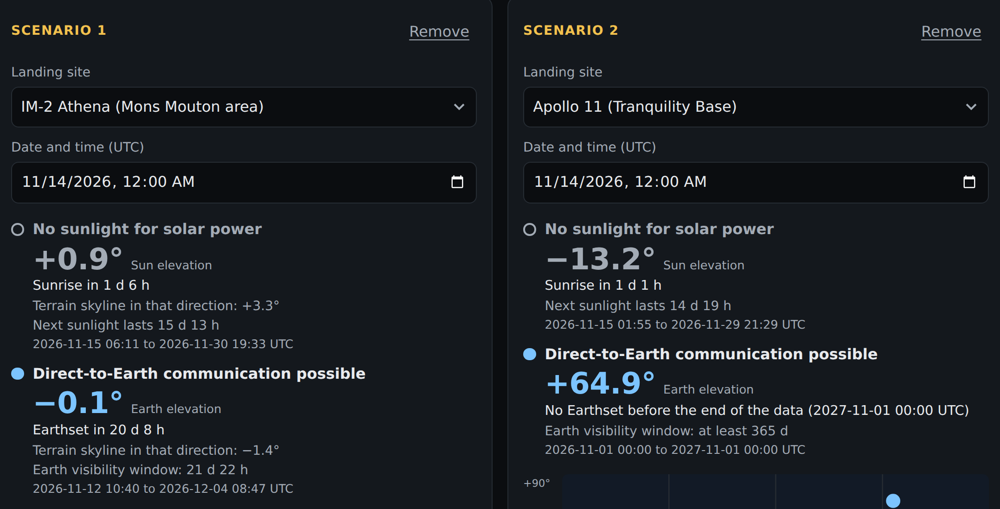
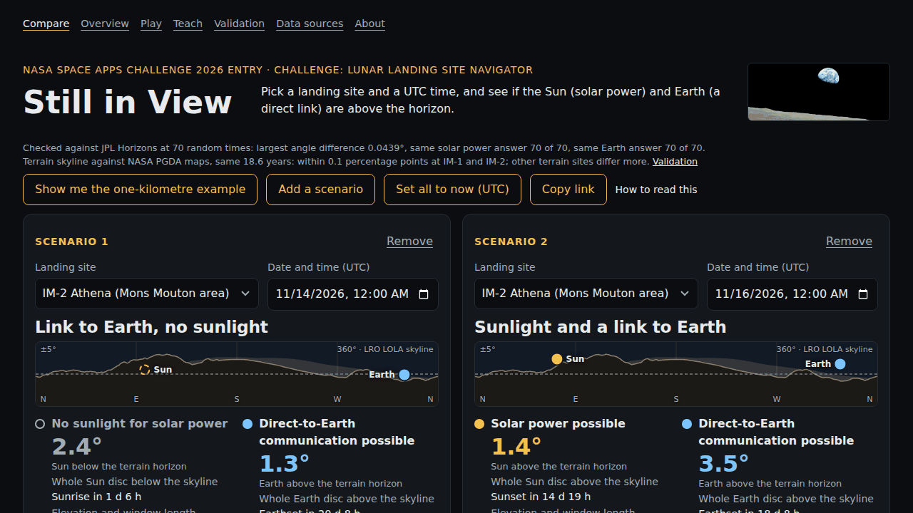

<h1 align="center">Still in View</h1>

<p align="center"><a href="https://github.com/aimanmalib/spaceapps26/actions/workflows/ci.yml"></a> <a href="LICENSE"></a></p>

<p align="center"><b>Compare landing sites and dates on the Moon: sunlight for power and a direct line to Earth.</b> · <i>Banding tapak dan tarikh pendaratan di Bulan: cahaya Matahari untuk kuasa dan talian terus ke Bumi.</i><br>
<a href="https://aimanmalib.github.io/spaceapps26/">try it</a> · <a href="https://aimanmalib.github.io/spaceapps26/?s=im-2,2026-11-14T00:00">the one-kilometre example</a> · <a href="https://aimanmalib.github.io/spaceapps26/demo/demo.pdf">slides, 7</a> · <a href="#validation-in-short">validation</a> · <a href="#run-it-locally">run it locally</a> · <a href="SI-DISCLOSURE.md">SI disclosure</a> · <a href="CHANGELOG.md">changelog</a></p>

**Try it:** <https://aimanmalib.github.io/spaceapps26/> (no sign-in; mirror: <https://spaceapps26.aimanmalib.com/>).
Demo deck, 7 slides: <https://aimanmalib.github.io/spaceapps26/demo/demo.pdf> (the same file as `demo/demo.pdf` in this repository).

Launch slipped, or the site changed? Still in View shows at once whether a landing site on the Moon still has sunlight for power
(Sun above the horizon) and a direct line to Earth (Earth above the horizon). Two things set it apart:

1. **It says when an answer is not certain.** Near the south pole the horizon is terrain, known only as well as the grid it was
   measured on. Each card marks an answer that would change within 80 m or with the lander's height, and the terrain skyline is
   checked against NASA's own illumination maps: within 0.1 percentage points at IM-1 and IM-2 over the same 18.6 years, with
   every place where it differs more shown and explained ([Validation](#validation)).
2. **One kilometre can decide.** Over one year at the IM-2 site Earth's centre is above the skyline 80.1 % of the hours; one
   kilometre east, 64.4 %; one kilometre south, 56.6 % ([the one-kilometre finding](#the-one-kilometre-finding)).

For planners: a GO / RISKY / NO-GO line for each scenario, a calendar of every site by day, ready comparisons such as "Launch
slipped two weeks", fourteen sites with three future south polar targets, and dates to the end of 2030.


Challenge: Lunar Landing Site Navigator, NASA Space Apps Challenge 2026 (Jakarta, virtual).
<https://www.spaceappschallenge.org/2026/challenges/lunar-landing-site-navigator/> Team: Aiman Malib.



## The one-kilometre finding

At the IM-2 site on 2026-11-14 00:00 UTC, Earth is 1.3° above the terrain horizon, but 1.5° below it 1 km east and 2.6° below it
1 km south. Over the whole year of data (8761 hourly steps), Earth's centre is above the skyline 80.1 % of the hours at the site,
64.4 % 1 km east and 56.6 % 1 km south. On a smooth Moon, 1 km would tilt the horizon by only 0.033°.
Open this case: <https://aimanmalib.github.io/spaceapps26/?s=im-2,2026-11-14T00:00> (mirror:
<https://spaceapps26.aimanmalib.com/?s=im-2,2026-11-14T00:00>), or press "Show me the one-kilometre example" on the home page.



## Validation in short

- Sun and Earth angles against JPL Horizons at 70 random site-and-time pairs: largest difference 0.0439°, same two answers at
  70 of 70 pairs (details under Validation below).
- Terrain horizon against the NASA GSFC PGDA visibility maps, over the same 18.6 years: at the IM-1 and IM-2 sites the Sun and
  Earth differ by 0.1 percentage points or less; at the other 4 listed terrain sites the Sun differs by 1.4 to
  15.6 points. At a ridge check point near the pole the Sun differs by 17.6 points; there the
  tool's own value runs from 57.2 % (observer on the ground) to 85.3 % (2 m up), and NASA's 67.7 % lies between (below).

## Run it locally

```
npm ci
npm run dev      # local copy at the address Vite prints
npm test         # JavaScript and Python unit tests
```

> "Your challenge is to create an intuitive tool or application that lets mission planners, educators, and the public compare landing
> sites and dates quickly, visualizing Sun and Earth positions relative to the horizon to assess power generation potential and
> direct-to-Earth communication windows."
> (challenge text, NASA Space Apps Challenge 2026)

AI disclosure: this project was built with SI (Claude Code, Anthropic); who decided what is listed under
[AI disclosure](#ai-disclosure-super-intelligence--si-use) below and in [`SI-DISCLOSURE.md`](SI-DISCLOSURE.md).

## Features

Built during the event weekend (14–15 November 2026). Pages on the live site: Compare, Overview, Play, Teach, Validation, Data sources, About.

Built:

- Pick a landing site and a UTC date and time (2026-11-01 to the end of 2030); see the Sun and Earth relative to the horizon, whether solar power generation and
  direct-to-Earth communication are possible, and the elevation of each.
- Horizon first: every card opens with one short verdict (for example "Link to Earth, no sunlight") and a 360° strip of the
  horizon with the Sun and Earth on it; at the six south polar sites the ground in the strip is the LRO LOLA skyline. The strip's vertical
  scale (±5°, ±10°, ±20°, ±45° or ±90°, written in its corner) is the smallest that holds that card's Sun and Earth.
- Terrain range at the six south polar sites: under the two answers, each card says whether an answer changes somewhere inside the terrain
  range (the skylines of the nine points 80 m apart around the site, one LOLA pixel, with the observer at 0 m and at 2 m) and
  gives the one-year shares across it; the horizon strip draws the range as a band around the skyline. Measured, IM-2: the Sun's
  centre is above the skyline 43.8 % of the year's hours at the site and 40.0 % to 44.0 % across the range; Earth 80.1 % and
  74.7 % to 80.5 %. The Sun answer changes inside the range in 4.2 % of the hours and the Earth answer in 5.8 %
  (`data/band/`, `scripts/band.py`).
- Time remaining before sunset or Earthset (or until sunrise or Earthrise), the duration of sunlight and the Earth visibility window
  around the chosen time.
- Fourteen listed sites: ten known landing sites (all six Apollo landings, CLPS IM-1 and IM-2, Chandrayaan-3, Chang'e 4), the place
  where IM-1 Odysseus came to rest (80.13°S, 1.44°E, next to its nominal landing area), and three future south polar targets. Each
  coordinate is copied from a cited NASA page (NSSDCA, LROC or the NASA Technical Reports Server).
- Future south polar targets (challenge text: "future CLPS mission targets", "alternative sites in the same region"): three places
  NASA names for later landings, each with its own LOLA skyline, map, 1 km shifts and terrain range. Malapert Massif and Nobile
  Rim 1 are two of the nine candidate landing regions NASA listed in October 2024; the Shackleton connecting ridge is where NASA
  says Blue Origin's Blue Moon Mark 1, a CLPS flight, will attempt a landing. Each coordinate is one point that the cited LROC or
  NASA page gives inside the area (Malapert Massif in whole degrees), not a chosen landing point. Measured over the year: at the
  Shackleton ridge point the Sun is at least partly in view 81.7 % of the hours; at the Malapert Massif point Earth's centre is
  above the skyline 34.3 % of the hours, 100.0 % one kilometre north and 0.0 % one kilometre south. Compare them
  with IM-2 at one time:
  <https://aimanmalib.github.io/spaceapps26/?s=im-2,2026-11-14T00:00&s=malapert-massif,2026-11-14T00:00&s=nobile-rim-1,2026-11-14T00:00&s=shackleton-ridge,2026-11-14T00:00>
- Up to four scenarios at once, as cards and in one side-by-side table.
- Try a comparison: a row of ready-made comparisons above the cards, each one a shareable link: "Launch slipped two weeks" (IM-2 on
  2026-11-17 against 2026-12-01: the sunlight is lost, Earth stays in view), "IM-1: planned vs where it landed", "Apollo 11 vs the
  south pole" and "Ridge: summer vs winter" (`config/presets.json`; the tests recompute each comparison's answers from the data).
- Mission check on every card: a GO / RISKY / NO-GO line in the card head for a stay of 7, 14 or 29.5 days from the chosen time,
  and under the answers the numbers behind it: the share of hours with the Sun, Earth and both above the horizon used, the longest
  night, the longest gap without Earth, and a geometry estimate in W/m² for a vertical panel that turns to the Sun against a flat
  one (1361 W/m² × geometry × the visible share of the Sun's disc; no panel efficiency). GO needs the Sun in at least 70 % and
  Earth in at least 50 % of the hours and no night longer than 72 hours; one failed check gives RISKY, two or more NO-GO. These
  limits are settings (`config/metrics.json`), not the requirements of any mission.
- Dates to the end of 2030: the frozen JPL Horizons tables cover 2026-11-01 to 2027-11-01; later dates are computed in the browser
  on the same hourly grid, and each card says which source its angles come from (checked against JPL Horizons, below).
- Sequential comparison: buttons on every card step to the previous or next listed site (date kept) or move the time 1 day
  earlier or later (site kept). "If the date moves" lists the same two answers, with their margins from the horizon used, for the
  chosen time and the next 14 days at the same time of day, marks the dates where an answer differs and counts them. Measured
  example, IM-2 from 2026-11-14 00:00 UTC: solar power possible on 13 of 15 dates; direct-to-Earth on 15 of 15.
- Next windows (mission window finder): on every card, the next stretches in the data, from the chosen time on, when the Sun and
  Earth are both above the horizon used without a break for at least 1 day, 3 days, 7 days or 14 days (hourly table, centre of each
  disc; at most five listed), with start, end and length; a button sets the card to a window's start. One line gives the share of
  hours in the data when both are above it. Measured example, IM-2 (terrain horizon) from 2026-11-14 00:00 UTC: next window
  2026-11-15 07:00 to 2026-11-30 19:00 UTC (15 d 12 h); both above the horizon in 36.0 % of the hours.
- Shareable link: "Copy link" puts the cards in the web address (`?s=<site id>,<UTC time>`, one `s` per card; own coordinates
  `?s=custom,<lat>,<lon east>,<UTC time>`); opening it restores the cards, and values that cannot be read are skipped with a
  visible notice. "Set all to now (UTC)" moves every card to the current hour while it is inside the data (otherwise the button is
  off and says why). Above the side-by-side table, one plain sentence per scenario repeats the card's two answers.
- Play (educational game, challenge text: "an educational game"): `/play.html` (source `src/play.html`), six rounds from `config/game.json`. Each round
  shows one listed site and one UTC time; the player answers the two questions (Sun above the horizon used, Earth above it) and
  presses Check. The answers are not stored in the config: they are computed with the same tables, terrain skylines and judgement
  as the Compare page, with one sentence per answer giving the elevation, the horizon in that direction and the margin, the
  horizon picture and a link that opens the round in the tool. Score out of 12; no timer, account, storage or sound.
- Teach (page for teachers, SI suggestion chosen by the author): `/teach.html` (source `src/teach.html`), a 15-minute class
  activity in three steps from `config/teach.json` (the game; Apollo 11 and IM-2 at the same time; the one-kilometre example),
  each with one question and a link. The page holds no answers: they appear in the tool when a link is opened. Below the steps,
  the Moon and Earth rows quoted from the NASA fact sheets. Printing hides the navigation and shows each link as a full address.
- A timeline of one lunar day (29.5 Earth days) on every card: Sun and Earth elevation over time, bars for when each is in view,
  a slider to move through it and a Play button (hidden when the device asks for reduced motion). A switch shows the whole one-year
  table instead (hourly steps, 1 Nov 2026 to 1 Nov 2027), with the share of hours each one is at least partly above the horizon used;
  for the sites with a terrain skyline these are the same "this tool" numbers as in the NASA PGDA check below.
- Own coordinates: type any latitude and longitude on the Moon. Sun and Earth positions for these are computed in browser,
  validated against JPL Horizons (Astronomy Engine; differences below). They use the ideal sphere horizon only: local terrain is not
  computed for own coordinates, even inside the LRO LOLA grids.
- Local terrain horizon from LRO LOLA for the south polar sites inside the elevation grids used here (75°S to the pole: IM-1 at two points, IM-2 and the three future targets);
  every other site uses the ideal sphere horizon and says so.
- Small shifts in location or date: each card can list the same two answers for the chosen time moved 6 hours and 1 day either way,
  and, at the six terrain sites, for points 1 km north, east, south and west, each with its own LOLA terrain horizon.
  Measured example, IM-2 at 2026-11-14 00:00 UTC: Earth is 1.3° above the terrain horizon at the site, but 1.5° below it 1 km east
  and 2.6° below it 1 km south. On the ideal sphere, 1 km tilts the horizon by only 0.033°. The 80 m terrain grid does not
  resolve small craters such as the one where the IM-2 lander stopped. Over the whole year (8761 hourly steps, 2026-11-01 to
  2027-11-01), Earth's centre is above the skyline 80.1 % of the hours at the IM-2 site, 64.4 % 1 km east and 56.6 % 1 km south
  (Sun: 43.8 %, 35.1 %, 45.7 %); at IM-1, 100.0 % at the site and 83.2 % 1 km east (`data/shift-year/`, `scripts/shift_year.mjs`).
- Earth view, drawn to scale: right under the two answers at the terrain sites, a window of sky 26° wide toward Earth (or the
  Sun), with the same degrees across and up, the Earth disc 1.9° across, the LRO LOLA skyline and the smooth-Moon line (0°), and
  buttons for the site and the points 1 km north, east, south and west (same data as the small-shifts table).
- Whole disc or part of it: each Sun and Earth answer also says whether the whole disc, part of it, or none of it is above the
  horizon used (angular radius seen from the Moon: Sun 0.267°, Earth 0.95°, mean distances). The yes/no answer itself uses the
  centre of the disc, the same rule as in the validation below.
- Moon and Earth compared: each card can show the length of one day (29.53 days against 24 hours), how fast the Sun moves across
  the sky at the site and chosen time, surface air pressure and the distance to the horizon from 2 m up (2.64 km against 5.05 km),
  with day length, radius and pressure quoted from the NASA NSSDCA Moon and Earth fact sheets. It also gives how far Earth moves in
  the site's sky over the whole table. Measured, 2026-11-01 to 2027-11-01: at IM-2 Earth stays within a 16.15° range of azimuth and
  between −2.30° and +10.79° elevation; at Apollo 11 within 37.72° of azimuth and between +57.96° and +73.68°.
- A 2D map and a 3D surface of LRO LOLA heights, 80 × 80 km around each of the six terrain sites, with the site and the Sun and
  Earth directions at the chosen time. The 3D surface can be turned to look in any direction; its heights are stretched 2 times.
- Map layers (challenge text: "how to represent steep slopes and deep craters that create extreme shadow conditions"): buttons on
  the 2D map switch between Heights, Slope (degrees, computed in the page from the same LOLA heights, cells 0.5 km apart) and
  Average sunlight (NASA PGDA): NASA's average solar illumination map of the south pole (share of hourly steps over 18.6 years
  when any part of the Sun was visible), read on the same cells by `scripts/map_sunlight.py`, not computed by this tool. At the
  centre cell it gives 47 % at IM-1 and at IM-2, the PGDA values of the validation below.
- Day by day at every site (Overview page): a calendar of all listed sites by UTC day. Each cell shows how that day's 24 hours
  split between the Sun and Earth both in view, the Sun only, Earth only and neither; pick a month, sort by power, communication or
  both, and open any day on Compare (`data/calendar.json`, `scripts/calendar.mjs`).
- From the lander: in the 3D block of the terrain sites, a view from the lander's own position on the curved Moon, heights not
  stretched, facing Earth or the Sun, with the LOLA skyline drawn over the ground and both discs at their true size.
- Optional Indonesian and Malay interface text (SI translations, not reviewed by a native speaker): add `?lang=id` or `?lang=ms`
  to any page address, or use the links in the page footer. English stays the default; the choice is not stored.

## What it does, and limitations

I chose all three audiences named in the challenge (mission planners, educators, the public) and all twelve items (a–l) that SI listed
from the challenge text (its "Your solution may include" list and its "Potential Considerations"). The site's About page lists what is built for each item and its limitations; the Data
sources page lists every frozen data file with the request it came from.

Limitations:

- Dates (d): 2026-11-01 to 2030-12-31 UTC. The frozen JPL Horizons tables cover 2026-11-01 00:00 to 2027-11-01 00:00, one row per
  hour, interpolated in between; later dates use the in-browser engine on the same hourly grid. Every one-year number (Overview,
  calendar, year shares, the NASA PGDA checks) covers that first year only.
- Mission check: geometry only. The W/m² estimate uses 1361 W/m² (NASA NSSDCA Moon Fact Sheet) with no panel efficiency, no
  temperature and no Sun-distance correction, and the GO limits are settings, not the requirements of any mission.
- From the lander: the 3D ground uses 0.5 km cells out to 40 km, so its own skyline can differ from the LOLA 80 m line that the
  answers use (by up to 0.73° at the place where IM-1 came to rest); the view draws that line and says which one is judged.
- Terrain horizon (j): only at the six listed sites inside the LOLA south polar grids used here (75°S to the pole): IM-1 at two
  points, IM-2 and the three future targets.
  Every other listed site uses the ideal sphere horizon.
- Own coordinates (b): ideal sphere horizon only. Local terrain is not computed for own coordinates, even inside the LOLA grids.
- 2D map (h), 3D surface (i) and the 1 km location shifts (l): only at those six sites. Other sites show the date shifts only.
- Future targets: each is one point inside a candidate or target area several kilometres across, as given by the cited page, not
  a chosen landing point; the answers there change within a kilometre (the cards show the 1 km shifts and the terrain range).
- 3D surface (i): the Sun and Earth lines are drawn on top of the ground; terrain does not hide them, and no shadows are drawn.
- Map layers (h): this tool does not compute shadows on the map. The average sunlight layer is NASA's long-term average over
  18.6 years, not the one-year period of the tables; slopes shorter than 0.5 km are smoothed out.
- Terrain values on ridges: at a ridge the share of time with the Sun in view depends on the observer's height and changes within
  about 100 m (Validation, below). The tool places the observer 2 m above the ground everywhere. The terrain range on the
  terrain cards (nine points 80 m apart, observer at 0 m and at 2 m) is a sensitivity range for the 80 m LOLA grid, not an error
  bar on the real ground.
- Yes/no means the centre of the Sun or Earth disc is above the horizon; each answer also says when only part of the disc is above
  it (radius from mean distances). The independent terrain check (Validation, below) counts any part of the disc.
- Power and communication answers are geometry only: whether the Sun or Earth is above the horizon. Solar panel orientation, power
  output, antennas, relay satellites and link budgets are not modelled.
- Interface language: English is the default and the reference. Indonesian and Malay (`?lang=id`, `?lang=ms`, links in the page
  footer) are SI translations, not reviewed by a native speaker. Technical terms, numbers and site names are not changed.

## One year at every listed site

The Overview page (`overview.html`) counts every listed site over the whole data table (2026-11-01 00:00 to 2027-11-01 00:00 UTC,
8761 hourly steps). An hour counts when any part of the disc is above the horizon used, the rule of the one-year caption on
Compare. Counted by `scripts/overview.mjs` into `data/overview.json`; the tests check it against the tables, the caption and `data/validation.json`.
Read off the table (the page writes the same three lines from the file):

- Most hours with the Sun in view: Shackleton connecting ridge (Blue Moon Mark 1 target ridge), 81.7 %.
- Most hours with both the Sun and Earth in view: Apollo 12 (Ocean of Storms), 49.6 %.
- Longest unbroken stretch with both in view: IM-2 Athena (Mons Mouton area), 15.8 days (2026-11-15 to 2026-11-30).

| Site | Sun in view, % of hours | Earth in view, % | Both, % | Longest unbroken stretch with both | Horizon used |
|---|---|---|---|---|---|
| Apollo 11 (Tranquility Base) | 48.8 | 100.0 | 48.8 | 14.9 days (2026-11-15 to 2026-11-29) | ideal sphere |
| Apollo 12 (Ocean of Storms) | 49.6 | 100.0 | 49.6 | 14.9 days (2026-11-18 to 2026-12-03) | ideal sphere |
| Apollo 14 (Fra Mauro) | 49.5 | 100.0 | 49.5 | 14.9 days (2026-11-18 to 2026-12-03) | ideal sphere |
| Apollo 15 (Hadley-Apennine) | 49.0 | 100.0 | 49.0 | 15.0 days (2027-03-15 to 2027-03-29) | ideal sphere |
| Apollo 16 (Descartes Highlands) | 48.8 | 100.0 | 48.8 | 14.9 days (2026-11-15 to 2026-11-30) | ideal sphere |
| Apollo 17 (Taurus-Littrow) | 48.7 | 100.0 | 48.7 | 14.9 days (2027-03-12 to 2027-03-27) | ideal sphere |
| IM-1 Odysseus, nominal landing area (near Malapert A) | 45.6 | 100.0 | 45.6 | 15.1 days (2026-11-17 to 2026-12-02) | LOLA terrain |
| IM-2 Athena (Mons Mouton area) | 45.7 | 93.2 | 42.7 | 15.8 days (2026-11-15 to 2026-11-30) | LOLA terrain |
| Chandrayaan-3 Vikram (ISRO) | 49.0 | 100.0 | 49.0 | 15.6 days (2026-11-13 to 2026-11-29) | ideal sphere |
| Chang'e 4 (CNSA), lunar far side | 51.2 | 0.0 | 0.0 | none | ideal sphere |
| IM-1 Odysseus, where it came to rest | 39.3 | 100.0 | 39.3 | 13.0 days (2026-11-18 to 2026-12-01) | LOLA terrain |
| Malapert Massif (NASA Artemis candidate region) | 43.1 | 38.9 | 13.7 | 6.0 days (2027-10-16 to 2027-10-22) | LOLA terrain |
| Nobile Rim 1 (NASA Artemis candidate region) | 42.2 | 63.7 | 27.2 | 13.9 days (2026-11-15 to 2026-11-29) | LOLA terrain |
| Shackleton connecting ridge (Blue Moon Mark 1 target ridge) | 81.7 | 50.3 | 44.5 | 14.2 days (2027-09-12 to 2027-09-26) | LOLA terrain |

Sites with a terrain skyline and sites on the ideal sphere use different horizons, so their numbers are not like for like. Geometry only.

## Data

Sun and Earth positions come from the JPL Horizons System; terrain comes from LRO LOLA topography. All data is fetched by scripts in
`scripts/` at build time, frozen in `data/`, and listed with its source in `data/SOURCES.json`. Full citations: `REFERENCES.md`.

## Validation

Do the angles the tool shows match JPL Horizons? `scripts/validate.py` draws 70 site-and-time pairs at random (fixed seed,
never on a table hour) and compares the angles shown by the page's own code with Horizons asked directly for the same site and minute.
Result (`data/validation.json`, also on the site's Validation page):

| Angle | Largest difference | Average difference |
|---|---|---|
| Sun azimuth | 0.0439° | 0.0025° |
| Sun elevation | 0.0077° | 0.0021° |
| Earth azimuth | 0.0047° | 0.0018° |
| Earth elevation | 0.0043° | 0.0020° |

Largest difference over all angles: 0.0439°. Same solar power answer: 70 of 70;
same Earth communication answer: 70 of 70. The largest difference is the Sun azimuth at Apollo 14 (2027-08-03 22:41 UT) with the Sun 86.3° below the horizon,
where the azimuth changes fastest between two table hours.

Own coordinates are computed in browser, validated against JPL Horizons: `scripts/validate.py --engine` runs the page's engine
(Astronomy Engine, same hourly grid and interpolation) at the 70 pairs above and at 30 new pairs on 6 unnamed check points
(near side, far side, both poles), 100 pairs in all:

| Angle | Largest difference | Average difference |
|---|---|---|
| Sun azimuth | 0.0207° | 0.0017° |
| Sun elevation | 0.0070° | 0.0012° |
| Earth azimuth | 0.0446° | 0.0027° |
| Earth elevation | 0.0028° | 0.0010° |

Largest difference over all angles (engine): 0.0446°. Same solar power answer: 100 of 100; same Earth communication answer: 100 of 100.
The largest difference is the Earth azimuth on the far side (0°N 180°E, 2027-09-26 08:16 UT) with the Earth 88.4° below the
horizon, where azimuth is nearly undefined.

Dates after the frozen tables: `scripts/validate_years.py` compares the in-browser engine with JPL Horizons at 24 random
site-and-minute pairs at the listed sites in 2028 to 2030 (fixed seed, never on a table hour; `data/validation-years.json`): largest
difference 0.0045°, average 0.0013°, same solar power answer 24 of 24, same Earth communication answer
24 of 24.

Is the terrain horizon right? `scripts/pgda.py` compares it with an independent NASA product, the average Sun and Earth visibility
maps of the lunar south pole (E. Mazarico, NASA GSFC PGDA, LOLA grid 120 m per pixel), at 7 points. A map value is the share
of hourly steps over 18.6 years when any part of the disc was visible; the tool's value in this first table is the share of hours
in its own one-year table (2026-11-01 to 2027-11-01) when any part of the disc is above its terrain skyline. The second table
repeats the check over the same 18.6 years.

| Point | Sun visible, this tool | Sun visible, PGDA | Earth visible, this tool | Earth visible, PGDA |
|---|---|---|---|---|
| IM-1, nominal landing area | 45.6 % | 46.7 % | 100.0 % | 100.0 % |
| IM-2 | 45.7 % | 46.8 % | 93.2 % | 93.1 % |
| IM-1, where it came to rest | 39.3 % | 35.6 % | 100.0 % | 100.0 % |
| Malapert Massif | 43.1 % | 42.9 % | 38.9 % | 41.2 % |
| Nobile Rim 1 | 42.2 % | 41.8 % | 63.7 % | 67.7 % |
| Shackleton connecting ridge | 81.7 % | 65.9 % | 50.3 % | 51.9 % |
| Check point -89.45°, 222.69°E (not a landing site) | 85.7 % | 67.7 % | 53.3 % | 52.3 % |

Largest difference: Sun 18.0 percentage points, Earth 4.0 percentage points. At IM-1 (nominal landing area) and IM-2 the Sun
differs by 1.1 points and Earth by 0.1 or less; at the other 4 listed terrain sites the Sun differs by 0.2 to 15.8 points and
Earth by up to 4.0. The 18.0 points are at the check point 0.55° from the pole, on a ridge where the PGDA Sun value
itself ranges from 51.0 % to 84.7 % within the 3 × 3 pixels around it. It is reported as measured.

Over the same 18.6 years (`scripts/pgda_period.py`: the same skylines over 163048 hourly steps from 2009-07-13, with Sun and Earth
angles from the in-browser engine; the PGDA label gives the length of its simulation but not its dates):

| Point | Sun visible, this tool, 18.6 years | Sun visible, PGDA | Earth visible, this tool, 18.6 years | Earth visible, PGDA | Sun, lowest to highest calendar year |
|---|---|---|---|---|---|
| IM-1, nominal landing area | 46.6 % | 46.7 % | 100.0 % | 100.0 % | 45.0 % to 48.1 % |
| IM-2 | 46.9 % | 46.8 % | 93.2 % | 93.1 % | 45.5 % to 48.7 % |
| IM-1, where it came to rest | 40.2 % | 35.6 % | 100.0 % | 100.0 % | 38.8 % to 41.8 % |
| Malapert Massif | 41.5 % | 42.9 % | 40.5 % | 41.2 % | 39.7 % to 43.1 % |
| Nobile Rim 1 | 43.5 % | 41.8 % | 65.6 % | 67.7 % | 41.9 % to 45.0 % |
| Shackleton connecting ridge | 81.5 % | 65.9 % | 53.1 % | 51.9 % | 79.0 % to 82.0 % |
| Check point -89.45°, 222.69°E (not a landing site) | 85.3 % | 67.7 % | 55.4 % | 52.3 % | 82.3 % to 85.8 % |

At IM-1 (nominal landing area) and IM-2 the largest difference is 0.1 percentage points. At the other 4 listed terrain sites the
Sun differs by 1.4 to 15.6 points and Earth by 0.0 to 2.1: the largest is the Shackleton ridge point, a ridge like the
check point. At the check point the Sun still differs by 17.6 points
and Earth by 3.1, and each of the 18 full calendar years gives 82.3 % to 85.8 % for the Sun, so the length of the period does not
explain the difference. What moves the value there is detail smaller than one map pixel: with the observer on the ground (0 m) the
tool gives 57.2 % for the Sun, and at 2 m (the height the tool uses everywhere) 85.3 %; the PGDA value of 67.7 % lies between the
two. At the nine points 120 m apart around it (one PGDA pixel) the tool gives 58.7 % to 86.5 %. At 2 m the skyline there is set by
ground closer than 1 km in 473 of 720 directions.

The same check at 100 random points spread evenly over the area south of 80° S (fixed seed, `scripts/pgda_sample.py`; each point
has its own LOLA skyline, and its Sun and Earth angles come from the in-browser engine), against the PGDA pixel nearest each point:

| | Median difference | 90th percentile | Largest difference | Inside the PGDA range of the 3 × 3 pixels nearby |
|---|---|---|---|---|
| Sun visible | 0.9 | 2.4 | 10.7 | 61 of 100 |
| Earth visible | 1.1 | 5.6 | 21.8 | 64 of 100 |

Differences are in percentage points and are reported as measured. This sample uses the one-year table and has not been repeated
over 18.6 years. Every file
in `data/` can be rebuilt from the NASA sources with one command: [`docs/REPRODUCE.md`](docs/REPRODUCE.md).

## Tests

- `bash scripts/gerbang-ujian.sh`: build, JavaScript and Python unit tests.
- `python3 scripts/capture_media.py` then `python3 scripts/render_demo.py`: the screenshots in `docs/media/` and the demo deck
  `demo/demo.pdf` (Playwright; Pillow for the GIF).
- `python3 e2e/smoke.py <site URL>`: browser smoke test of a deployed copy (Chromium desktop 1280 px, laptop 1366 × 768,
  Chromium 320 px, WebKit iPhone 13): the comparison and validation pages work, no console errors,
  no requests to other hosts, no horizontal overflow. Needs the Python `playwright` package and its browsers.
- `python3 e2e/subpath.py`: the same smoke test on `dist/` served under `/spaceapps26/`, as GitHub Pages serves it.
  `bash deploy/pages.sh` pushes that build to branch `gh-pages` (Pages itself is switched on in the repository settings).

## AI disclosure (Super Intelligence / SI use)

SI was used in this project: Claude Code (Anthropic).

- **Decided by me (the author):** to take part, the Jakarta event, this challenge, the three audiences and the twelve items to
  build, chosen from a list SI drew from NASA's challenge text; the project name, chosen from names SI suggested; on 15 November, four
  further options that NASA's challenge text names (sequential comparison, an educational game, terrain for custom coordinates,
  slopes and shadow conditions on the map), all chosen from a list SI made of that text; and, also on 15 November, five further
  features that SI suggested at my request (mission window finder, shareable links with a plain verdict and a Now button, a page
  for teachers, a guided tour), all chosen by me from that list, then three more that SI suggested (a real NASA photograph on the
  first screen, a one-year overview of every listed site, Indonesian and Malay interface options), also all chosen by me. On the
  evening of 15 November: to aim for a Global Award and to adopt changes from an SI red-team review of the entry (so far the PGDA
  comparison over the same 18.6 years, with the ridge-point test; a 360° horizon strip with a one-line verdict at the top of
  every card; the terrain range on the terrain cards; and four more south polar sites, three of them future targets that SI
  picked from NASA and LROC pages that state a coordinate). Also that evening: to add features that other public entries to this
  challenge had and this one lacked (ready-made comparisons, a mission check, a calendar of every site by day, a view from the
  lander, dates to the end of 2030); SI compared the entries and several SI sessions built the features in parallel.
- **Done by SI, on my instructions:** a feasibility comparison of the challenges, translation of the challenge text into Malay for
  me, build order, interface design, all code, data scripts and tests, slide layout, suggested project names, the red-team review of
  the entry with its measurements and the changes adopted from it, the optional Indonesian and
  Malay interface translations (not reviewed by a native speaker), and the English text, drafted from my choices and the measured
  results and reviewed by me.
- **Not used:** no SI-generated images, video or audio. Every image is a real screenshot of the tool, except one credited NASA
  photograph (Apollo 8, AS08-14-2383) on the home page, the About page and slide 1.

Generated source files carry the header `SI-generated: Claude Code (Anthropic)`; each page has an `si-disclosure` meta tag and a
footer line. Full statement with "Who decided what": [`SI-DISCLOSURE.md`](SI-DISCLOSURE.md). Machine-readable form:
[`si-disclosure.json`](si-disclosure.json).

## License

Apache License 2.0 (`LICENSE`). Third-party data and libraries keep their own terms (`NOTICE`, `REFERENCES.md`).
