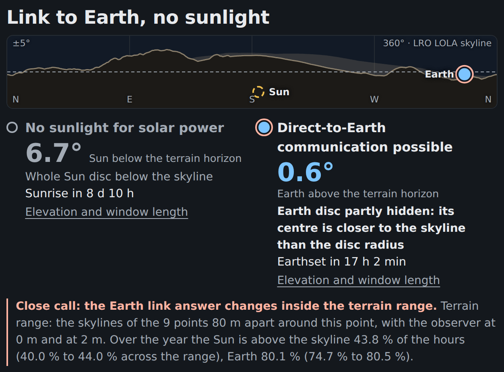
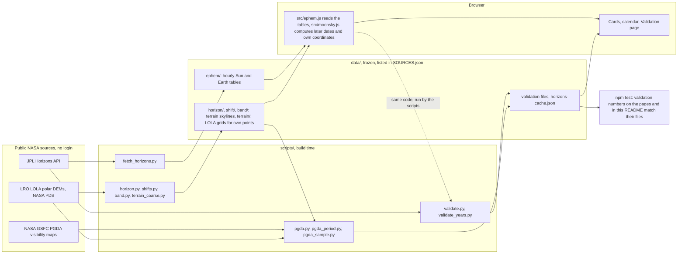

<h1 align="center">Still in View</h1>

<p align="center"><a href="https://github.com/aimanmalib/spaceapps26/actions/workflows/ci.yml"></a> <a href="LICENSE"></a></p>

<p align="center"><b>Compare landing sites and dates on the Moon: sunlight for power and a direct line to Earth.</b> · <i>Banding tapak dan tarikh pendaratan di Bulan: cahaya Matahari untuk kuasa dan talian terus ke Bumi.</i><br>
<a href="https://aimanmalib.github.io/spaceapps26/">try it</a> · <a href="https://aimanmalib.github.io/spaceapps26/?s=im-2,2026-11-14T00:00">the one-kilometre example</a> · <a href="https://aimanmalib.github.io/spaceapps26/demo/demo.pdf">slides, 7</a> · <a href="https://youtu.be/0vr8Z7KkWDs">demo video (30 s)</a> · <a href="#validation-in-short">validation</a> · <a href="#run-it-locally">run it locally</a> · <a href="SI-DISCLOSURE.md">SI disclosure</a> · <a href="CHANGELOG.md">changelog</a></p>

**Try it:** <https://aimanmalib.github.io/spaceapps26/> (no sign-in; mirror: <https://spaceapps26.aimanmalib.com/>).
Demo deck, 7 slides: <https://aimanmalib.github.io/spaceapps26/demo/demo.pdf> (the same file as `demo/demo.pdf` in this repository).

Launch slipped, or the site changed? Still in View shows at once whether a landing site on the Moon still has sunlight for power
(Sun above the horizon) and a direct line to Earth (Earth above the horizon). Two things set it apart:

1. **It says when an answer is not certain.** Near the south pole the horizon is terrain, known only as well as the grid it was
   measured on. Each card marks an answer that would change within 80 m or with the lander's height, and the terrain skyline is
   checked against NASA's own illumination maps: within 0.1 percentage points at IM-1 and IM-2 over the same 18.6 years, with
   every place where it differs more shown and explained ([Validation](docs/DETAILS.md#validation)).
2. **One kilometre can decide.** Over one year at the IM-2 site Earth's centre is above the skyline 80.1 % of the hours; one
   kilometre east, 64.4 %; one kilometre south, 56.6 % ([the one-kilometre finding](#the-one-kilometre-finding)).

For planners: a GO / RISKY / NO-GO line for each scenario, with the longest night and an example battery size for it; a calendar
of every site by day; ready comparisons such as "Launch slipped two weeks"; eighteen sites with seven future south polar targets
(six of NASA's nine Artemis III candidate regions); a terrain skyline for your own coordinates south of 75°S; lunar eclipses, when
Earth hides the Sun from a lit site (matched to NASA's eclipse list); the hourly table behind each card as a CSV file; and dates
to the end of 2070. Checked against JPL Horizons at
972 random site-and-minute pairs: every yes/no answer the same.



Challenge: Lunar Landing Site Navigator, NASA Space Apps Challenge 2026 (Jakarta, virtual).
<https://www.spaceappschallenge.org/2026/challenges/lunar-landing-site-navigator/> Team: Aiman Malib.


## The one-kilometre finding

At the IM-2 site on 2026-11-14 00:00 UTC, Earth is 1.3° above the terrain horizon, but 1.5° below it 1 km east and 2.6° below it
1 km south. Over the whole year of data (8761 hourly steps), Earth's centre is above the skyline 80.1 % of the hours at the site,
64.4 % 1 km east and 56.6 % 1 km south. On a smooth Moon, 1 km would tilt the horizon by only 0.033°.
Open this case: <https://aimanmalib.github.io/spaceapps26/?s=im-2,2026-11-14T00:00> (mirror:
<https://spaceapps26.aimanmalib.com/?s=im-2,2026-11-14T00:00>), or press "Show me the one-kilometre example" on the home page.


## Validation in short

- Sun and Earth angles against JPL Horizons at 720 random site-and-minute pairs (40 at each of the 18 listed sites,
  2026-11-01 to 2030-12-31, frozen tables and in-browser engine): largest difference 0.0152°, same solar power answer
  720 of 720, same Earth answer 720 of 720. With the earlier checks: 972 different site-and-minute pairs (3888 reference angles),
  every yes/no answer the same, 972 of 972 (details under [Validation](docs/DETAILS.md#validation)).
- Terrain horizon against the NASA GSFC PGDA visibility maps, over the same 18.6 years: at the IM-1 and IM-2 sites the Sun and
  Earth differ by 0.1 percentage points or less; at the other 8 listed terrain sites the Sun differs by 0.0 to
  15.6 points. At a ridge check point near the pole the Sun differs by 17.6 points; there the
  tool's own value runs from 57.2 % (observer on the ground) to 85.3 % (2 m up), and NASA's 67.7 % lies between (below).

## What a scientist can check

The numbers on the site are read from files in `data/`, and `npm test` checks the validation results quoted on the pages and in
this README against those files. To repeat a claim, run its line; `git diff data/` then shows what changed (retrieval dates
always change). No account, key or login is needed.

| Claim | Data file | Repeat it |
|---|---|---|
| Sun and Earth angles match JPL Horizons at every listed site, 2026 to 2030 | `data/validation-scale.json`; raw answers `data/horizons-cache.json` | `rm data/horizons-cache.json && python3 scripts/validate.py --scale` |
| The page's hourly interpolation of the frozen tables | `data/validation.json` (`horizons`) | `python3 scripts/validate.py` |
| Own coordinates: the in-browser engine at unnamed points | `data/validation.json` (`engine`) | `python3 scripts/validate.py --engine` |
| Dates after the frozen tables, 2028 to 2070 | `data/validation-years.json` | `python3 scripts/validate_years.py` |
| Terrain skyline against NASA PGDA maps: same 18.6 years; random points | `data/validation.json` (`pgda_period`; `pgda_sample`) | `python3 scripts/horizon.py --download && python3 scripts/pgda_period.py && python3 scripts/pgda_sample.py` |
| The one-kilometre finding | `data/shift-year/shift-year.json` | `python3 scripts/horizon.py --download && python3 scripts/shifts.py && node scripts/shift_year.mjs` |
| The frozen Sun and Earth tables | `data/ephem/<site>.json` | `python3 scripts/fetch_horizons.py im-2` |
| All of the above, from the public NASA sources | all of `data/` | `bash scripts/reproduce.sh` ([steps](docs/REPRODUCE.md)) |

The check at scale sends one Horizons request per site and body (`TLIST` of minutes), at most one per second, retried after errors;
a second run reads `data/horizons-cache.json` and sends none. `--download` (LOLA, about 145 MB) saves outside the repository.



## What we do not claim

Taken from the [limitations](docs/DETAILS.md#what-it-does-and-limitations); nothing here is new.

- Geometry only. A yes means the centre of the Sun or Earth disc is above the horizon used. Solar panel orientation, power
  output, antennas, relay satellites and link budgets are not modelled; the GO / RISKY / NO-GO limits and the W/m² estimate
  (1361 W/m², no panel efficiency, temperature or Sun-distance correction) are settings, not the requirements of any mission.
- Terrain from the LOLA grids only: at the ten listed south polar sites (80 m grid) and at own coordinates south of 75°S
  (coarser copies, 400 m or 960 m, except within 20 km of the pole). Every other listed site, and own coordinates north of 75°S,
  use the ideal sphere horizon. The terrain range (nine points 80 m apart, observer at 0 m and 2 m) is a sensitivity range for
  the 80 m grid, not an error bar on the real ground; on ridges the answer changes within about 100 m.
- One year for the year numbers. Overview, calendar and year shares cover 2026-11-01 to 2027-11-01 (the NASA PGDA check is
  also repeated over the maps' own 18.6 years); later dates come from the in-browser engine (checked against JPL Horizons, above), not from frozen tables.
- Future targets are points, not landing sites: each is one point inside a candidate or target area several kilometres across.
- The 3D surface does not hide the Sun and Earth lines behind terrain and draws no shadows; the lander view's 0.5 km ground can
  differ from the 80 m skyline that the answers use.
- Indonesian and Malay are SI translations, not reviewed by a native speaker.

## Run it locally

```
npm ci
npm run dev      # local copy at the address Vite prints
npm test         # JavaScript and Python unit tests
```

> "Your challenge is to create an intuitive tool or application that lets mission planners, educators, and the public compare landing
> sites and dates quickly, visualizing Sun and Earth positions relative to the horizon to assess power generation potential and
> direct-to-Earth communication windows."
> (challenge text, NASA Space Apps Challenge 2026)

AI disclosure: this project was built with SI (Claude Code, Anthropic); who decided what is listed under
[AI disclosure](#ai-disclosure-super-intelligence--si-use) below and in [`SI-DISCLOSURE.md`](SI-DISCLOSURE.md).

## Features, limitations and the full validation

The reference part of this README is in [docs/DETAILS.md](docs/DETAILS.md):

- [Features](docs/DETAILS.md#features): every feature, with the item of the challenge text it answers, (a) to (l).
- [What it does, and limitations](docs/DETAILS.md#what-it-does-and-limitations): each limit in full.
- [One year at every listed site](docs/DETAILS.md#one-year-at-every-listed-site): the table of all eighteen sites.
- [Data](docs/DETAILS.md#data): where each file comes from.
- [Validation](docs/DETAILS.md#validation): every table of the checks against JPL Horizons and the NASA PGDA maps.

## Tests

- `bash scripts/gerbang-ujian.sh`: build, JavaScript and Python unit tests.
- `python3 scripts/capture_media.py` then `python3 scripts/render_demo.py`: the screenshots in `docs/media/` and the demo deck
  `demo/demo.pdf` (Playwright; Pillow for the GIF).
- `python3 e2e/smoke.py <site URL>`: browser smoke test of a deployed copy (Chromium desktop 1280 px, laptop 1366 × 768,
  Chromium 320 px, WebKit iPhone 13): the comparison and validation pages work, no console errors,
  no requests to other hosts, no horizontal overflow. Needs the Python `playwright` package and its browsers.
- `python3 e2e/subpath.py`: the same smoke test on `dist/` served under `/spaceapps26/`, as GitHub Pages serves it.
  `bash deploy/pages.sh` pushes that build to branch `gh-pages` (Pages itself is switched on in the repository settings).
- `bash scripts/lighthouse.sh`: Lighthouse 12 scores of Compare and Overview on a local production build (default mobile
  settings, simulated throttling). Measured on 15 November 2026, two runs on a busy shared server (Lighthouse 12.8.2):

| Page | Performance | Accessibility | Best practices | SEO |
|---|---|---|---|---|
| Compare | 54, 60 | 100, 100 | 100, 100 | 100, 100 |
| Overview | 98, 96 | 96, 96 | 100, 100 | 100, 100 |

  Compare loses about 25 Performance points to layout shift of the comparison section after load (CLS 1.07), the rest to blocking
  time, which changes with the server's load. Overview accessibility: the calendar cells are below Lighthouse's touch-target size.

## AI disclosure (Super Intelligence / SI use)

SI was used in this project: Claude Code (Anthropic).

- **Decided by me (the author):** to take part, the Jakarta event, this challenge, the three audiences and the twelve items to
  build, chosen from a list SI drew from NASA's challenge text; the project name, chosen from names SI suggested; on 15 November, four
  further options that NASA's challenge text names (sequential comparison, an educational game, terrain for custom coordinates,
  slopes and shadow conditions on the map), all chosen from a list SI made of that text; and, also on 15 November, five further
  features that SI suggested at my request (mission window finder, shareable links with a plain verdict and a Now button, a page
  for teachers, a guided tour), all chosen by me from that list, then three more that SI suggested (a real NASA photograph on the
  first screen, a one-year overview of every listed site, Indonesian and Malay interface options), also all chosen by me. On the
  evening of 15 November: to aim for a Global Award and to adopt changes from an SI red-team review of the entry (so far the PGDA
  comparison over the same 18.6 years, with the ridge-point test; a 360° horizon strip with a one-line verdict at the top of
  every card; the terrain range on the terrain cards; and four more south polar sites, three of them future targets that SI
  picked from NASA and LROC pages that state a coordinate). Also that evening: to add features that other public entries to this
  challenge had and this one lacked (ready-made comparisons, a mission check, a calendar of every site by day, a view from the
  lander, dates to the end of 2030, later 2040, 2050 and 2070); SI compared the entries and several SI sessions built the features in parallel.
- **Done by SI, on my instructions:** a feasibility comparison of the challenges, translation of the challenge text into Malay for
  me, build order, interface design, all code, data scripts and tests, slide layout, suggested project names, the red-team review of
  the entry with its measurements and the changes adopted from it, the optional Indonesian and
  Malay interface translations (not reviewed by a native speaker), and the English text, drafted from my choices and the measured
  results and reviewed by me.
- **Not used:** no SI-generated images, video or audio. Every image is a real screenshot of the tool, except one credited NASA
  photograph (Apollo 8, AS08-14-2383) on the home page, the About page and slide 1.

Generated source files carry the header `SI-generated: Claude Code (Anthropic)`; each page has an `si-disclosure` meta tag and a
footer line. Full statement with "Who decided what": [`SI-DISCLOSURE.md`](SI-DISCLOSURE.md). Machine-readable form:
[`si-disclosure.json`](si-disclosure.json).

## License

Apache License 2.0 (`LICENSE`). Third-party data and libraries keep their own terms (`NOTICE`, `REFERENCES.md`).
